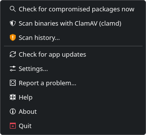
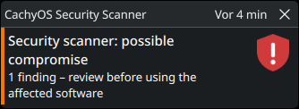
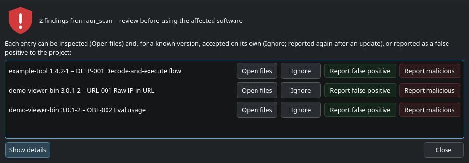
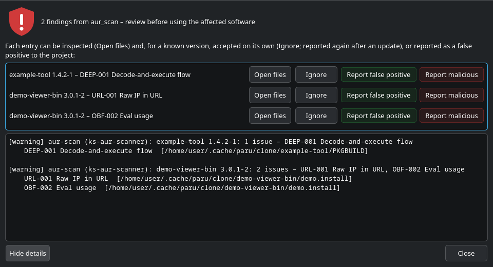

  

<h1 align="center">CachyOS Security Scanner</h1>

  
  

Tray app for CachyOS/Arch desktops. It runs in the background, scans on a schedule, and shows a
notification when something is found. It only provides the UI and scheduling; detection is done by
external tools. Removal of flagged packages is optional and always needs your click. Each scanner has its own options in the settings, including validated extra arguments.

## Which projects do the AUR scans?

This app does not detect anything itself. The AUR scans are done by these independent open-source projects; this app
only runs them, keeps them up to date and shows their results. All credit for the detection goes to their authors.

| Project | Repository | What it does | License |
|---|---|---|---|
| **aur-malware-check** | [lenucksi/aur-malware-check](https://github.com/lenucksi/aur-malware-check) | Checks installed AUR packages (and IOC files, pacman log, caches) against lists of packages compromised in known attack campaigns. | GPL-3.0 |
| **ks-aur-scanner** (`aur-scan`) | [KiefStudioMA/ks-aur-scanner](https://github.com/KiefStudioMA/ks-aur-scanner) | Heuristic analysis of the PKGBUILDs and install scripts of installed AUR packages (off by default). Optionally the app [fetches and unpacks packages no helper cache holds](docs/scanner-lifecycle.md#-packages-that-no-helper-cache-holds). | GPL-3.0-or-later |
| **ClamAV** (binary scan, on request or scheduled) | [Cisco-Talos/clamav](https://github.com/Cisco-Talos/clamav) · [clamav.net](https://www.clamav.net/) | Antivirus engine (`clamdscan` / `clamd`) for scanning installed binaries. | GPL-2.0 |

The two [community lists](lists/) (blocklist, false positives) are maintained in this repository.
These tools are separate programs with their own licenses; this app starts them as external processes and does not
include their code.

## How the scanners are installed and kept up to date

You do not install the AUR scanners yourself; the app does it, in your home folder (`~/.local/share/cachy-security-scanner/vendor/`), without root rights.

| Step | What happens |
|---|---|
| **First scan** | `git clone --depth 1` of **aur-malware-check**. For **aur-scan** (if you enable it) the app clones the repository and builds it once with Rust (`cargo`). If you already installed `aur-scanner` from the AUR, that binary is used instead. |
| **Before every scan** | `git pull --ff-only` on aur-malware-check; aur-scan is switched to its newest stable release (setting *Update scanner sources before each scan*) and rebuilt only when that changed. |
| **Broken checkout** | detected with `git fsck`, deleted and cloned again automatically. |
| **Cannot be set up** | (no `git`, no Rust, Python too old, no network) the scan shows an **error** in the history and a ❌ tray icon. It never reports "clean" for a scanner that did not run. |
| **Community lists** | downloaded as signed files from this repository's releases checked at start, before every scan and hourly, downloaded when changed; verified before use. |

Everything runs with low CPU/I/O priority. Details and the exact commands: **[Scanner lifecycle](docs/scanner-lifecycle.md)**; see also [Scanners and community lists](docs/scanners-and-lists.md), [Requirements](docs/setup-requirements.md), [How it works](docs/how-it-works.md).

Note: the scanners are third-party code that is downloaded from GitHub and run as your user; they are not signature-checked by this app (only the app's own updates and the community lists are). See the trust table in [How it works](docs/how-it-works.md#-trust-and-verification).

## Screenshots

| | |
|---|---|
| **Tray menu**  | **Notification**  |
| **Findings window**  | **With details**  |

_The tray menu and the findings window show made-up example data (KDE Breeze Dark, without window title bars); the notification is from an earlier version and looks like your desktop's notifications._

## Install (CachyOS / Arch)

1. Open the [Releases page](https://github.com/ruepp-jenkins/cachyos-security-scanner/releases) and pick the
   newest release.
2. Under **Assets**, download `cachy-security-scanner.pkg.tar.zst`.
3. Open a terminal in the download folder and install it with pacman:

       sudo pacman -U cachy-security-scanner.pkg.tar.zst

pacman pulls in the dependencies (see the `PKGBUILD`).

4. Start "CachyOS Security Scanner" from the application menu.

Later versions update themselves from GitHub Releases. Remove with `sudo pacman -Rns cachy-security-scanner`.

If a release has no `.pkg.tar.zst` asset, you can build it yourself: download the `PKGBUILD` from the same
release into an empty directory and run `makepkg -si`.

## What it does

- Sits in the system tray, scans on a schedule, after package installs/updates and on request, and notifies you when
  something is found. Nothing is removed without your click and confirmation.
- Runs the scanners above with low priority, keeps them up to date by itself and shows each scanner's result separately in the scan history.
- One findings window, kept current by later scans, lets you open the files behind an entry in your editor, accept an entry
  for one software version or (if you wish) remove the package. Repeated scans with the same result stay quiet.
- An *About* window shows versions, paths and the state of scanners and lists; reports to the project are prefilled with them.
- Two signed community lists (known malicious packages, known false positives) are maintained in [`lists/`](lists/); proposals are welcome.
- Updates itself from signed GitHub releases.

## 📖 Help

The full help starts at **[docs/README.md](docs/README.md)**; the tray entry **Help** opens it for your version.

| | |
|---|---|
| 🚀 [Getting started](docs/getting-started.md) | 🔔 [Tray icon and notifications](docs/tray-and-notifications.md) |
| 📜 [Scan history](docs/scan-history.md) | 🔎 [Findings window](docs/findings-window.md) |
| ⚙️ [Settings reference](docs/settings.md) | 🧪 [Scanners and community lists](docs/scanners-and-lists.md) |
| 🦠 [Set up ClamAV](docs/setup-clamav.md) | 🧰 [Requirements](docs/setup-requirements.md) |
| 🔄 [Updates](docs/updates.md) | 🔁 [Scanner lifecycle](docs/scanner-lifecycle.md) |
| 🩹 [Troubleshooting](docs/troubleshooting.md) | 🧩 [AUR helpers](docs/aur-helpers.md) |
| 🔬 [How it works (files, network, privileges)](docs/how-it-works.md) | 🏗️ [Maintainer notes](docs/maintainers.md) |

## License and disclaimer

Released under the [MIT License](LICENSE): everyone may use, copy, modify and distribute it, free of charge. It comes
**without any warranty and without liability** of the author(s) (see `LICENSE`).

This is a helper, not a guarantee. It can miss malicious packages and it can report harmless ones; a clean result does
not prove that your system is safe, and the tools it relies on have their own limits. You are responsible for what you
install and remove. Review findings yourself before acting on them.
