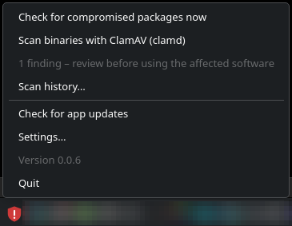
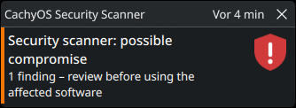
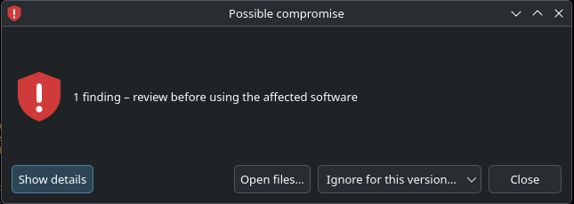
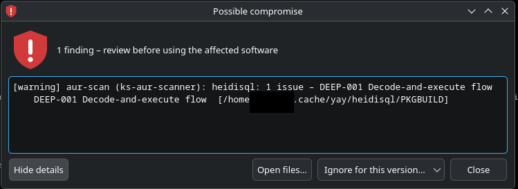
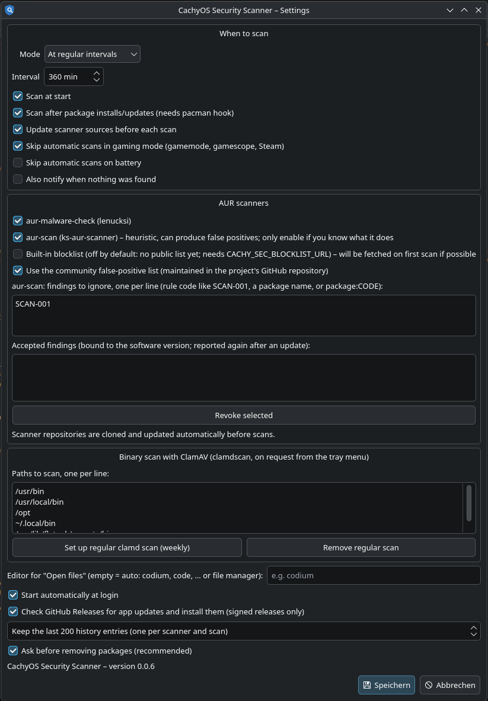

# CachyOS Security Scanner

Tray app for CachyOS/Arch desktops. It runs in the background, scans on a schedule, and shows a
notification when something is found. It only provides the UI and scheduling; detection is done by
external tools. Removal of flagged packages is optional and always needs your click.

## Screenshots
| | |
|---|---|
| **Tray menu**  | **Notification**  |
| **Findings window**  | **With details**  |

**Settings**

_Screenshots show version 0.0.6; newer versions differ in details (e.g. per-entry Ignore buttons, list status lines)._

## Install (CachyOS / Arch)
1. Open the [Releases page](https://github.com/ruepp-jenkins/cachyos-security-scanner/releases) and pick the
   newest release.
2. Under **Assets**, download `cachy-security-scanner.pkg.tar.zst`.
3. Open a terminal in the download folder and install it with pacman:

       sudo pacman -U cachy-security-scanner.pkg.tar.zst

pacman pulls in the dependencies (`python`, `pyside6`, `git`, `libnotify`, `openssh`).
4. Start "CachyOS Security Scanner" from the application menu (it also autostarts on next login).

Later versions update themselves from GitHub Releases (see Auto-update). Remove with
`sudo pacman -Rns cachy-security-scanner`.

If a release has no `.pkg.tar.zst` asset, you can build it yourself: download the `PKGBUILD` from the same
release into an empty directory and run `makepkg -si`.

## Backends (toggle each in Settings)
| Backend | Source | Notes |
|---|---|---|
| aur-malware-check | https://github.com/lenucksi/aur-malware-check | Blocklist/IOC check of installed AUR packages. Community tool, not endorsed by Arch. Needs Python 3.14+. Cloned and kept up to date automatically (`git clone`/`git pull --ff-only`); a corrupt or diverged checkout is deleted and re-cloned. Needs Python 3.14+ (checked; a clear error otherwise). |
| aur-scan | https://github.com/KiefStudioMA/ks-aur-scanner (AUR: `aur-scanner`) | **Off by default**: heuristic static analysis of installed AUR packages, can produce false positives; enable it if you know what it does. Findings can be ignored by rule code, package or `package:CODE` (default list: `SCAN-001`, a "could not be analyzed" note) in Settings. Uses the `aur-scan` on PATH; otherwise cloned and built with `cargo build --release -p aur-scanner-cli` automatically and rebuilt after upstream changes (upstream ships no binaries; the package depends on `rust`, `clang`, `pkgconf`, `openssl` for this). A failed build is reported as an error with the build output in the history. |
| Community blocklist | `lists/blocklist_aur.json` in this repository (signed, published on the `lists` release) | **On by default.** Known malicious AUR packages, matched against installed packages by name and version. Independent of third-party scanner upkeep; the settings show when the list was published. |
| ClamAV (`clamdscan`) | https://www.clamav.net | Binary scans run **only on request** from the tray menu: a terminal window opens with the live `clamdscan --fdpass --multiscan -i` output and stays open until you press Enter. Needs the `clamav` package and a running daemon (`sudo systemctl enable --now clamav-daemon`). Settings can set up a weekly systemd user timer. |

Checkouts live in `~/.local/share/cachy-security-scanner/vendor/`; only directories there are ever deleted.

## Features
Tray menu (right click): check now (always reports, even when clean), ClamAV binary scan in a terminal window, last result, scan history, settings.
Scan at start, at intervals or manual only; after package installs/updates via a pacman hook;
skipped in gaming mode (gamemode/gamescope/Steam) or on battery if enabled.

## Develop
    python3 -m unittest discover -s tests     # core logic, no Qt needed
    PYTHONPATH=src python3 -m cachy_sec        # needs PySide6

## Status / caveats
The Qt UI and the real tools' JSON/exit-code formats were not run or verified against the live tools
(no Arch host, no PySide6 in the dev container). Adapters parse defensively; check them on a real system.

## Autostart
The app registers itself for login: on start it writes `~/.config/autostart/cachy-security-scanner.desktop`
(no root needed, setting "Start automatically at login", on by default). Turning it off removes that file, or, if the
package ships the system-wide entry, writes `Hidden=true` over it. If the panel is not ready right after login, the
app waits up to 60 s for the system tray.

## Inspecting findings
The "Possible compromise" window has an **Open files…** button for aur-scan findings. It opens the package's
folder from the scanner's cache (PKGBUILD, install script, wrapper, …) in an editor: the one set under Settings, else the
first of `codium`, `vscodium`, `code`, `code-oss`, `cursor`, `zed`, `subl`, else the file manager. Several affected
packages give a menu. The folder is only opened, nothing in it is run; with VSCodium/VS Code keep the folder in
Restricted Mode (do not "trust" it).

## Accepting a finding (aur-scan)
In the "Possible compromise" window every entry (one rule of one package) has its own **Ignore** button, so you can
tick them off one by one. It accepts that rule for exactly the version of the scanned PKGBUILD (`epoch:pkgver-pkgrel`, read from the `.SRCINFO` next to it in the helper cache, e.g. `~/.cache/yay/<pkg>`; the installed version is used if there is none); the re-scan
runs once when you close the window. It is stored in
`~/.config/cachy-security-scanner/ignored_findings.json` and can be revoked in Settings. After the package is
updated the entry no longer matches, so the finding is reported again if it still applies; a different rule code for
the same version is reported too. If the installed version cannot be determined, nothing is hidden. The static
list in Settings (default `SCAN-001`) is separate and applies to every package and version.

## Community lists
Two lists live in [`lists/`](lists/) and are published signed on the rolling `lists` release (a workflow validates, stamps and signs them on every change; the app verifies the signature against its embedded key and shows in Settings when each list was published). **Blocklist** (`blocklist_aur.json`, on by default): known malicious AUR packages. **False positives** (below, opt-in).

## Community false-positive list (aur-scan, opt-in)
Heuristic scanners cry wolf. The project keeps a list of **known false positives per software version** in
[`lists/false-positives_aur-scan.json`](lists/false-positives_aur-scan.json); each entry records package, versions, rule codes,
author, report date, a reason and optionally a description. Tick *"Use the community false-positive list"* under the
aur-scan settings to let the app hide exactly those findings (it is **off by default**: you decide whether to trust the
list). The list only hides; every hidden finding is noted in the scan log with its reason, author and date. It is
published signed on the rolling `lists` release and verified against the app's embedded key; without a valid
signature nothing is hidden. To report one, use the issue template *Report an aur-scan false positive* or open a pull
request (see [`lists/README.md`](lists/README.md)).

## Scan history
Tray menu → "Scan history…" lists every scan, with **one entry per scanner** (start time, scanner, trigger, status, summary); selecting one shows its
full log, including the raw output of each scanner. A scanner that is enabled but cannot be set up or run gets an entry with status `error` and the reason
(and the scan is reported as incomplete, tray red). Automatic scans that were skipped (e.g. gaming mode) are recorded too. Binary scans are logged from the terminal window (`*-binaries.log`). Files live in
`~/.local/share/cachy-security-scanner/history/` as plain JSON/text; the number kept is set in Settings
(default 200, oldest are pruned).

## Auto-update (GitHub Releases only)
The app checks the latest GitHub release at start and daily, and can be triggered from the tray menu.
No build is needed because the app is pure Python; GitHub Actions only packages and signs it.

Release flow for maintainers:
1. One-time: `ssh-keygen -t ed25519 -f release_key`; put the public key line into `SIGNER_PUBKEY`; check
   repo `GITHUB_REPO` (already set to `ruepp-jenkins/cachyos-security-scanner`) in `src/cachy_sec/updater.py`; store the private key as the
   repository secret `RELEASE_SIGNING_KEY`.
2. Nothing to bump in the code: the version comes from the release tag. The workflow stamps it into
   `__init__.py`, `pyproject.toml` and `PKGBUILD` via `scripts/set-version.sh` (the files in git stay at `0.0.0`).
3. Create a GitHub release tagged `vX.Y.Z`. `.github/workflows/release.yml` stamps the version, tests, builds
   `cachy-security-scanner-X.Y.Z.tar.gz`, `SHA256SUMS` and `SHA256SUMS.sig` and attaches them.

Client side: downloads only from github.com / githubusercontent.com over HTTPS, verifies the SSH signature
(`ssh-keygen -Y verify`) against the embedded key, then the SHA-256, extracts safely into
`~/.local/share/cachy-security-scanner/updates/` and restarts the app by itself as soon as nothing is running
(no package scan, no open dialog); the tray menu also has "Restart to apply update". When started directly
instead of through the `cachy-security-scanner` launcher (e.g. from source) it only notifies. The running version
is shown in Settings and in the tray menu. Without a configured key updates are refused. A new version that crashes within 30 s of start is
discarded and the packaged version runs. The pacman-installed files are never modified; if the package
catches up to the downloaded version the downloaded copy is dropped.
