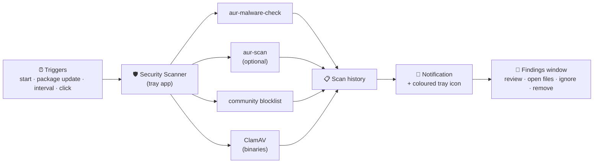

# 🛡️ CachyOS Security Scanner – Help

Welcome! This is the help for the **CachyOS Security Scanner**, a small tray tool for CachyOS / Arch desktops that
watches your system for **compromised AUR packages** and (on request) **malware in binaries**.

> **The most important thing first:** the app does **not detect anything itself**. It is the *user interface and
> scheduler* around independent, open-source scanners. It starts them, keeps them up to date, collects their results and
> tells you. Nothing is ever removed without your click and your confirmation.

## ⚡ In 30 seconds

| You see | It means |
|---|---|
| 🟢 green shield in the tray | the last scan found nothing |
| 🟠 orange shield | warnings – worth a look |
| 🔴 red shield | **critical** – a known-bad or very suspicious package |
| ❌ red cross | a scan could not run (setup problem) – see the history |

## 📚 Help pages

### Using the app
| Page | What you find there |
|---|---|
| 🚀 [Getting started](getting-started.md) | Install, first start, what happens in the first minutes |
| 🔔 [Tray icon and notifications](tray-and-notifications.md) | The tray menu, icon colours, click behaviour, notifications |
| 📜 [Scan history](scan-history.md) | Reading, sorting, filtering the log of all scans |
| 🔎 [Findings window](findings-window.md) | What to do when something is found: open files, ignore, remove |
| ⚙️ [Settings reference](settings.md) | Every option, its default and its key in the settings file |
| 🧪 [Scanners and community lists](scanners-and-lists.md) | Which tool does what, false positives, signed lists |
| 🔄 [Updates](updates.md) | How the app updates itself and why that is safe |
| 🔁 [Scanner lifecycle](scanner-lifecycle.md) | Where the scanner tools come from, how they are checked, updated and called |

### Setting things up
| Page | What you find there |
|---|---|
| 🦠 [Set up ClamAV](setup-clamav.md) | Install and test `clamd` for binary scans, step by step |
| 🧰 [Requirements and optional parts](setup-requirements.md) | Tray support, notifications, polkit, git/Rust, Python version, pacman hook |
| 🩹 [Troubleshooting](troubleshooting.md) | Typical problems and how to fix them |

### For technical readers
| Page | What you find there |
|---|---|
| 🔬 [How it works / transparency](how-it-works.md) | Every file it writes, every program it starts, every server it contacts, every privilege it uses |
| 🏗️ [Maintainer notes](maintainers.md) | Releasing, community-list workflow, update trust model, tests |

## 🧭 Typical first steps
1. **Install** the package → [Getting started](getting-started.md).
2. Look at the tray icon. After about a minute the first scan runs; **left-click** the icon to see the
   [scan history](scan-history.md).
3. Optional: tune [when to scan](settings.md#when-to-scan), switch on `aur-scan`, or
   [set up ClamAV](setup-clamav.md) for binary scans.

## ⚠️ Limits you should know
- A clean result is **not a guarantee**. Scanners only know what they know: new attacks can be missed, harmless packages
  can be flagged.
- You decide what to do with a finding. Read it, open the files, search for the package name before removing anything.
- The tools behind the scans are separate projects with their own limits; see [Scanners and community lists](scanners-and-lists.md).

*This help matches the version you run: the **Help** button in the settings opens the page of your version's tag on GitHub.*
