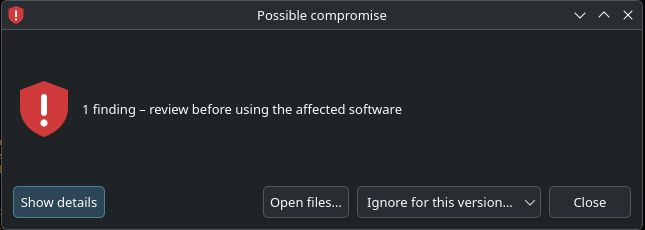
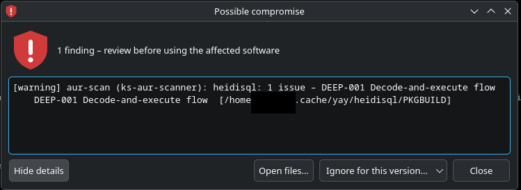

# 🔎 Findings window ("Possible compromise")

← [Help overview](README.md)

When a package scan finds something, the app shows a notification and opens this window. It is your **review desk**:
you see every finding, inspect the files behind it, accept entries you consider harmless, or – if you decide so – remove a
package.

> 🧠 **A finding is a hint, not a verdict.** A blocklist match means "this package/version is on a list of compromised
> software". A heuristic finding (`aur-scan`) means "this looks suspicious". Check before you act.

*(The screenshots are from an older version; newer versions have the per-entry buttons described below.)*

## What you see

| Part | Purpose |
|---|---|
| **Title and scan info** | the summary and when the scan ran (`14:32, automatic scan`). Several findings windows can be open at once |
| **One row per finding** | severity, title, package and version; with *Show details* also the explanation and rule codes |
| **Buttons per entry** | **Open files** and **Ignore** (below) |
| **Notes** | what the app did with the results, e.g. *"1 finding hidden by the community false-positive list"* |
| **(outdated) banner** | a newer scan finished after this window opened, so the list may no longer be current. Look at the newest scan |
| **Show details** | expands the explanations |
| **Remove packages…** | removal flow, only for critical findings of known packages |
| **Close** | closes the window; nothing changes |

## Buttons

### 📂 Open files

Opens the **folder** with the files the scanner looked at (usually the PKGBUILD folder in your AUR helper's cache) in
your editor – or in the file manager if no editor is found.

- **Nothing is executed.** The app starts the editor with the *folder path* as its only argument. It does not run files
  from the folder, does not open single files with their default handler and does not use a shell.
- ⚠️ An editor that opens a whole folder may be able to run things from it (for example VS Code tasks in
  `.vscode/tasks.json`). Keep the folder in **Restricted Mode** and answer *No* when the editor asks whether you trust
  the folder.
- Choose your editor with *Editor for "Open files"* in the [settings](settings.md#general) (empty = automatic).

### ✅ Ignore

Accepts **one entry**: this package, **in this version**, for this rule. It is a deliberate "I looked at it, it is fine".

- The next scan no longer reports exactly that. After an update of the package (new version) it is reported again if it
  still applies.
- Greyed out when the version is unknown (it cannot be bound to a version then).
- Ignores are listed in [Settings → Accepted findings](settings.md#ignoring-findings); **Revoke selected** undoes one.
- After you ignore something, the app rescans so the result is current.

### 🗑️ Remove packages…

Offered only for **critical** findings that map to an installed package.

1. You click the button; a confirmation lists the packages (unless you switched this off in the settings).
2. The system asks for your password (polkit).
3. The app runs `pkexec pacman -Rns --noconfirm -- <packages>`.

This is the only place where the app uses root rights. Check the list in the confirmation: removing the wrong package
could break software that depends on it.

## A sensible way to handle a finding

1. **Read** the title, details and rule codes. Use *Show details*.
2. **Open files** and look at the PKGBUILD and install scripts: unusual downloads, `curl | sh`, obfuscated code, unknown
   sources?
3. **Search** for the package name and version together with "malware" or "AUR comment" (the AUR page's comments are
   often the first place where attacks are reported).
4. Decide:
   - **Looks wrong** → *Remove packages…*, and if you used the software, consider that credentials on that machine could
     be affected.
   - **Harmless (false positive)** → *Ignore*. You can also propose it for the community list, see
     [Scanners and community lists](scanners-and-lists.md#-reporting-a-false-positive-or-a-malicious-package).
   - **Unsure** → leave it, ask in the package's AUR comments or the Arch forums.

The complete record stays in the [scan history](scan-history.md).
