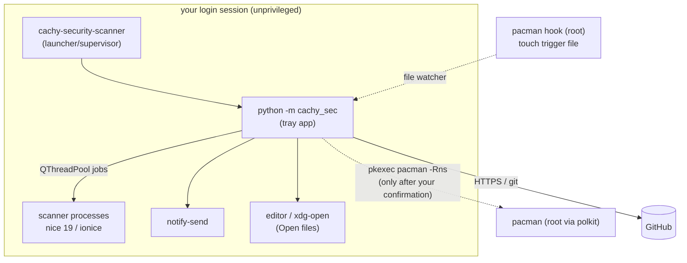

# 🔬 How it works – transparency for technical readers

← [Help overview](README.md)

This page states exactly **what the app does on your machine**: which files it writes, which programs it starts, which
servers it contacts and which privileges it uses. If something here is wrong, that is a bug – please open an issue.

## 🧩 Overview

| Property | Value |
|---|---|
| Language / UI | Python 3.12+, PySide6 (Qt 6) |
| Process model | one user-level process per login session (single-instance lock), no daemon, no root service |
| Role | **orchestrator and UI** – it does not contain detection logic |
| Detection | external programs, started as separate processes (see below) |
| Network | only GitHub (see below); no telemetry, no account |
| Root rights | only via polkit for a package removal you confirm, plus one `touch` in a pacman hook |
| License | MIT; the scanners keep their own licenses and are **not bundled** |



## 📁 Files the app writes

All paths follow the XDG standard; the defaults are shown.

### Configuration – `~/.config/cachy-security-scanner/`
| File | Content |
|---|---|
| `settings.json` | all [settings](settings.md); plain JSON, editable while the app is closed |
| `ignored_findings.json` | entries you accepted with *Ignore* (package + version + rule) |

### Data – `~/.local/share/cachy-security-scanner/`
| Path | Content |
|---|---|
| `history/` | the [scan history](scan-history.md): `*.json` per scanner and scan, `*-binaries.log` |
| `vendor/aur-malware-check/` | `git clone --depth 1` of the scanner |
| `vendor/ks-aur-scanner/` | clone of `aur-scan` and its Rust build output (`target/`), only if `aur-scan` is not installed from the AUR |
| `updates/<version>/` and `updates/current` | a verified downloaded update of the app, see [Updates](updates.md) |
| `binary-last-scan`, `binary-last-success` | timestamps of the last ClamAV scan attempt and the last one that ran to a result (used to schedule the next) |

### Cache – `~/.cache/cachy-security-scanner/`
| Content | Notes |
|---|---|
| the two community lists and their signatures, small status markers | replaced only by a verified download |

### Other places
| Path | Content |
|---|---|
| `$XDG_RUNTIME_DIR/cachy-security-scanner.lock` | single-instance lock (an `flock`; the kernel releases it, no stale lock is possible). Fallback `~/.cache/cachy-security-scanner/instance.lock` |
| `~/.config/autostart/cachy-security-scanner.desktop` | autostart entry; with autostart off a `Hidden=true` override |
| `~/.config/systemd/user/cachy-sec-clamd.{service,timer}` | **only** if you created the timer in an older version; the app no longer creates it |

### Installed by the package (root, via pacman)
| Path | Purpose |
|---|---|
| `/usr/lib/python*/site-packages/cachy_sec/` and `/usr/bin/cachy-security-scanner` | the program |
| `/usr/share/libalpm/hooks/cachy-security-scanner.hook` | the [pacman hook](setup-requirements.md#-the-pacman-hook) |
| `/usr/lib/tmpfiles.d/cachy-security-scanner.conf` | creates `/var/lib/cachy-security-scanner/` and the trigger file |
| `/var/lib/cachy-security-scanner/trigger` | empty file whose modification time the hook updates |
| `/etc/xdg/autostart/cachy-security-scanner.desktop`, `/usr/share/applications/…`, `/usr/share/icons/hicolor/scalable/apps/…` | autostart entry, menu entry, icon |
| `/usr/share/licenses/cachy-security-scanner/LICENSE` | license |

The app writes **nothing** outside these places, except what the external tools do on their own (below).

## 👀 What the app reads

| Source | Why |
|---|---|
| `/proc/*/comm` | detect gaming mode (names such as `gamemoded`, `gamescope`, `reaper`, `SteamLaunch`, `lutris-wrapper`); only the process *names*, nothing else |
| `/sys/class/power_supply/*` | detect battery operation |
| output of `pacman -Qm` | list of foreign (AUR) packages with versions for the blocklist and for version binding |
| `.SRCINFO` next to a scanned PKGBUILD (AUR helper cache, e.g. `~/.cache/yay/<pkg>`, `~/.cache/paru/…`) | the version that was actually scanned |
| the scanners' output | parsed into findings |
| the trigger file `/var/lib/cachy-security-scanner/trigger` (mtime) | start a scan after a pacman transaction |

The scanners themselves read more, according to their own documentation: `aur-malware-check` looks at the pacman log,
systemd units, package-manager caches and known indicator files; `aur-scan` reads PKGBUILDs and install scripts of installed
AUR packages; ClamAV reads the files in the paths you configure. See [Scanners](scanners-and-lists.md).

## ⚙️ Programs the app starts

The lifecycle of the scanners (sources, health check, update, exact invocation, exit codes) has its own page: [Scanner lifecycle](scanner-lifecycle.md).

No shell is ever used (`shell=False`, argument lists); paths are passed as single arguments.

| Program | When | Purpose |
|---|---|---|
| `git clone --depth 1`, `git pull --ff-only`, `git fsck`, `git rev-parse` | before scans | install / update / verify the scanner checkouts |
| `cargo build --release --locked -p aur-scanner-cli` | when `aur-scan` is on and its source changed | build `aur-scan` |
| `python3.x -m aur_check --json` | package scan | `aur-malware-check` |
| `aur-scan --no-color system --fail-on high` | package scan, `aur-scan` on | `aur-scan` |
| `pacman -Qm` | package scan, blocklist | list AUR packages |
| `clamdscan --fdpass --multiscan -i -- <paths>` | binary scan | ClamAV client; terminal on request, background when scheduled |
| `nice -n 19`, `ionice -c 2 -n 7` | in front of the heavy commands above | low priority (setting) |
| `ssh-keygen -Y verify` | updates and lists | signature check |
| `notify-send` | notifications. For clickable ones (findings, errors) with `--action=… --wait`, which keeps one short-lived helper process per open notification (at most 10) until it is clicked or dismissed | |
| editor of your choice / `xdg-open` | *Open files*, *Open folder* | **folder path as the only argument**; never a file from a finding |
| a terminal emulator (`xdg-terminal-exec`, `konsole`, …) | binary scan on request | shows live output |
| `pkexec pacman -Rns --noconfirm -- <packages>` | *Remove packages…* after your confirmation | the only root action |
| `systemctl --user …` | only the *Remove old systemd timer* button | clean up an old timer |

Environment: scanners inherit your environment. The launcher sets `CACHY_SEC_SUPERVISED=1` for the app process.

## 🌐 Network access

The app talks **only to GitHub**. It refuses any other host, including after redirects.

| Destination | Purpose | Frequency |
|---|---|---|
| `api.github.com/repos/ruepp-jenkins/cachyos-security-scanner/releases` | find the newest release | 30 s after start, then daily (if automatic updates are on), or manual check |
| `github.com/…/releases/download/vX.Y.Z/…` | update tarball, `SHA256SUMS`, signature | only when a newer version exists |
| `github.com/…/releases/download/lists/…` | the two community lists and their signatures | at start, hourly check, download when older than 6 h |
| `github.com/lenucksi/aur-malware-check.git` | clone / pull of the scanner (done by `git`) | before scans (setting) |
| `github.com/KiefStudioMA/ks-aur-scanner.git` | clone / pull of `aur-scan` (done by `git`) | before scans, only if `aur-scan` is on and not installed from the AUR |

Further traffic comes from the external tools, not from the app: `cargo` downloads Rust crates from crates.io when it
builds `aur-scan`; `aur-malware-check` may fetch its reference lists as described in its repository; `freshclam`
updates ClamAV signatures. Check the projects' documentation for details.

**What GitHub sees:** the usual request metadata (your IP address, a `User-Agent: cachy-security-scanner` header). The
app sends **no information about your system, your packages or your findings** anywhere.

## 🔐 Trust and verification

| Asset | Protection |
|---|---|
| App updates | SSH signature (ed25519, namespace `cachy-security-scanner`) over `SHA256SUMS` + SHA-256 of the tarball; public key embedded in the app; HTTPS; GitHub hosts only; safe extraction; crash fallback |
| Community lists | own signature namespace per list; verified on download and on every load; unverified lists are ignored; they can only add a finding (blocklist) or hide a specific finding for an exact version (false positives) |
| Scanner checkouts | fetched over HTTPS with `git`; **not** signature-verified by this app (the upstream projects are trusted at the level of their GitHub repositories). A broken checkout is deleted and cloned again |

Honest note on the last row: the scanners are third-party code that this app downloads and runs **as your user**. That is
the trade-off for always-current detection. If you do not accept it, switch the scanner off and rely on the others, or
install `aur-scan` from the AUR (`aur-scanner`) so it is built and updated by your usual process.

## 🔑 Privileges

| Action | Privilege |
|---|---|
| everything the app normally does | your user, no elevated rights |
| writing the trigger file | the **pacman hook**, as root, one `touch` on one file; it never runs a scan and never blocks pacman |
| removing packages | `pkexec` (polkit) – asks for your password, runs only `pacman -Rns --noconfirm -- <names>`; only after the confirmation, and package names are checked against a strict pattern first (anything else is refused) |
| no `setuid` helpers, no systemd system service, no `sudo` | |

## 🧵 Runtime behaviour

- **Single instance:** a second start exits at once with a message. Two instances would double all timers and tray icons.
- **Scans run in worker threads** (`QThreadPool`), the UI stays responsive. Only one package scan runs at a time; a
  package change during a scan queues one more afterwards.
- **Settings are re-read from disk before every scan**; the file on disk is the source of truth.
- **Timers:** interval scan timer (if on), hourly lists check, daily update check, 10-minute poll for the binary
  interval, 5-second restart poll (only while an update waits), 3-second refresh (only while the history window is open).
  Otherwise the app is idle.
- **Low priority:** heavy commands are started with `nice`/`ionice` when the setting is on.
- **Skipped scans:** automatic scans are skipped in gaming mode / on battery (settings). Manual scans never are.
- **Failure policy:** a scanner that cannot be set up or run produces an **error entry**; the app never reports "all
  clear" when an enabled scanner did not run.

## 🧱 What the app deliberately does not do

- No detection of its own, no signature database of its own.
- No removal, quarantine or killing of anything without your explicit action. ClamAV runs without `--remove`/`--move`.
- No execution of files from a finding; no opening of single files with a default handler.
- No telemetry, no crash reports, no accounts, no ads.
- No installation into system folders by itself; updates stay in your home directory.

## 🔎 Verify it yourself

```bash
# which files does the package own?
pacman -Ql cachy-security-scanner

# what does the app have open / which processes does it spawn during a scan?
ls -l /proc/$(pgrep -f 'python -m cachy_sec')/fd
pstree -a $(pgrep -f 'python -m cachy_sec')

# which hosts does it talk to? (needs strace; run for the duration of a scan)
strace -f -e trace=connect -p $(pgrep -f 'python -m cachy_sec') 2>&1 | grep -v AF_UNIX

# read the code: it is small
python3 -c "import cachy_sec, pathlib; print(pathlib.Path(cachy_sec.__file__).parent)"
```

Source: [github.com/ruepp-jenkins/cachyos-security-scanner](https://github.com/ruepp-jenkins/cachyos-security-scanner).
