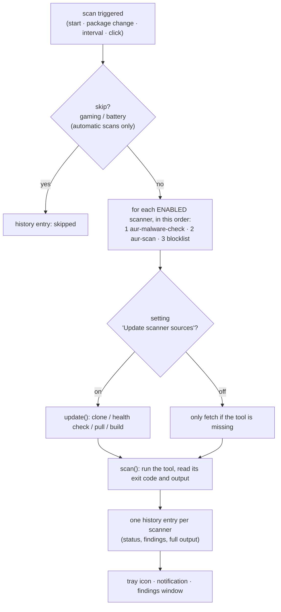
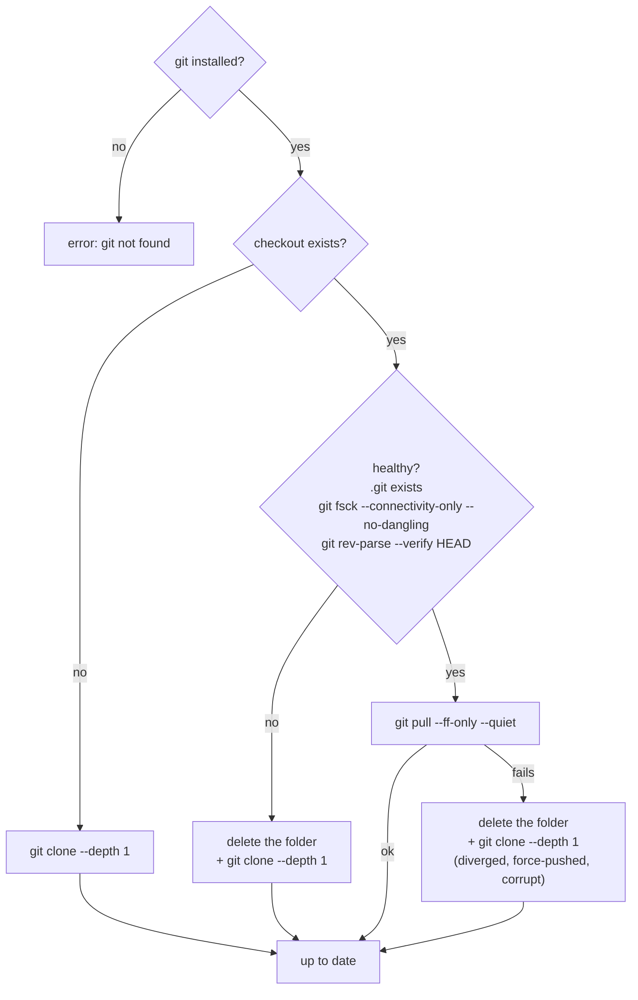

# 🔄 Scanner lifecycle: where the tools come from, how they are checked, updated and called

← [Help overview](README.md) · related: [Scanners and community lists](scanners-and-lists.md) · [How it works](how-it-works.md)

This page follows a scanner from "not on your machine" to "result in the scan history". It is written for people who want
to know exactly what happens, in what order, with which commands.

## 🗺️ Overview



Key rules:
- **Only enabled scanners run.** A disabled scanner is not fetched, not updated and not started.
- A scanner that **cannot** be prepared or started produces an **error entry** – never silence, never a fake "clean".
- A failing *update* never blocks the *scan*: if the pull fails, the existing checkout is used when it still works.
- All heavy commands start with `nice -n 19` and `ionice -c 2 -n 7` when *Run scans with low priority* is on.

## 📍 1. Where the tools come from

| Scanner | Source | How it reaches you |
|---|---|---|
| **aur-malware-check** | [github.com/lenucksi/aur-malware-check](https://github.com/lenucksi/aur-malware-check) | `git clone --depth 1 https://github.com/lenucksi/aur-malware-check.git` into `~/.local/share/cachy-security-scanner/vendor/aur-malware-check/` – unless a system-wide command `aur-malware-check` already exists in your `PATH`; then that one is used and **not** managed by the app |
| **aur-scan** (ks-aur-scanner) | [github.com/KiefStudioMA/ks-aur-scanner](https://github.com/KiefStudioMA/ks-aur-scanner) | uses `aur-scan` from your `PATH` if present (for example from the AUR package `aur-scanner`). Otherwise `git clone --depth 1 https://github.com/KiefStudioMA/ks-aur-scanner.git` into `vendor/ks-aur-scanner/` and **builds it with Rust** (upstream publishes no prebuilt binary) |
| **Community blocklist** | this repository, release `lists` | a signed JSON file downloaded by the app itself (no external tool), see [Scanners and community lists](scanners-and-lists.md#-community-lists) |
| **ClamAV** | your distribution (`pacman -S clamav`) | you install it; the app only calls `clamdscan`, see [Set up ClamAV](setup-clamav.md) |

Everything the app fetches lives in your home folder. **No root rights** are used to install or update scanners.

## 🩺 2. How a checkout is checked and updated

The app keeps its checkouts in a single folder, `~/.local/share/cachy-security-scanner/vendor/`. Before every scan (with
*Update scanner sources before each scan* on) it runs this procedure for each git-managed scanner:



| Step | Command | Timeout |
|---|---|---|
| clone | `git clone --depth 1 <url> <dir>` | 5 min |
| health check | `git -C <dir> fsck --connectivity-only --no-dangling`, then `git -C <dir> rev-parse --verify HEAD` | 2 min / 30 s |
| update | `git -C <dir> pull --ff-only --quiet` | 3 min |
| recovery | delete the folder, clone again | – |

Safety details:
- **Deletion is restricted:** the app only ever deletes a folder that sits **directly inside** its own `vendor/` folder. It
  refuses any other path.
- A **failed clone** never leaves a half-cloned folder behind.
- Clones are **shallow** (`--depth 1`): only the latest state is downloaded.
- With the update setting **off**, a missing tool is still fetched once on demand (otherwise there would be nothing to run).

> ⚠️ **Trust note.** The checkouts follow the **default branch** of the upstream repositories. The app does **not** pin a
> commit and does **not** verify signatures for them (unlike its own updates and the community lists). Whatever
> upstream publishes is what will run, as your user. That is the price of getting new detection rules without waiting for
> a release of this app. If you do not accept that, switch the scanner off, or install it from a source you trust (for
> `aur-scan`: the AUR package `aur-scanner`) – the app then uses your installed command and does not touch it.

## 🛠️ 3. What "update" additionally does per scanner

### aur-malware-check
After the pull, the app runs the tool's own refresh of its campaign lists:

```
<python> -m aur_check --refresh-campaigns          # timeout 2 min
```

What that command downloads, and from where, is up to the upstream tool – see
[its repository](https://github.com/lenucksi/aur-malware-check).

### aur-scan
`aur-scan` has to be compiled. The app builds it **only when needed**: when the checkout changed (a new commit arrived) or
no built binary exists yet.

```
cargo build --release --locked -p aur-scanner-cli --manifest-path ~/.local/share/cachy-security-scanner/vendor/ks-aur-scanner/Cargo.toml
```

- Timeout: 1 hour. Runs at low priority. `--locked` builds exactly the dependency versions upstream pinned.
- `cargo` downloads the Rust crates from crates.io on the first build.
- The result is `vendor/ks-aur-scanner/target/release/aur-scan`.
- If the build fails, the app deletes the checkout **once**, clones again and retries. If it still fails, the scan reports
  an **error** with the last line of the build output (the full log is in the history).
- Requirements: `git`, `cargo` (package `rust`), and for building `clang`, `pkgconf`, `openssl` – all dependencies of the
  app's package. See [Requirements](setup-requirements.md#-rust-only-for-aur-scan).

### Community blocklist and false-positive list
They are not git checkouts. Signed files are downloaded from the `lists` release of this repository, verified with
`ssh-keygen -Y verify`, and cached in `~/.cache/cachy-security-scanner/`. A scan itself only downloads when no verified
copy exists at all; the regular refresh happens at app start and hourly (download when older than 6 hours).

## ▶️ 4. How the tools are called for a scan

All commands are started **without a shell** (argument lists), inherit your environment, and run in a worker thread so the
UI stays responsive. Output (stdout and stderr together) is captured and stored in the history.

### aur-malware-check
```
nice -n 19 ionice -c 2 -n 7  env PYTHONPATH=<vendor dir>  <python>  -m aur_check  --json
```

- `<python>` is the first of `python3.15`, `python3.14`, `python3` that is **3.14 or newer** (upstream's minimum). If none
  qualifies, the scanner is "not available" with that reason.
- If a system command `aur-malware-check` exists, it is called instead: `aur-malware-check --json`.
- Timeout: 15 minutes.
- **Exit code → status:**

  | Exit code | Status | Meaning |
  |---|---|---|
  | 0 | clean | nothing found |
  | 1 | warning | issues found |
  | 2 | critical | compromised packages found |
  | anything else | error | the tool failed; the output is in the log |

- The JSON is walked defensively: list entries under keys that look like *infected / compromised / critical / malicious*
  become **critical**, under *warning / suspicious* **warning** findings. If the status is not clean but no entry can be
  extracted, a generic finding "Tool reported issues; see its output" is created, so a result is never lost.

### aur-scan
```
nice -n 19 ionice -c 2 -n 7  aur-scan --no-color system --fail-on high
```

- `system` makes it analyse the PKGBUILDs of your installed AUR packages (from your AUR helper's cache).
- `--fail-on high` makes it exit non-zero when something at severity *high* or above is found.
- Timeout: 30 minutes.
- **Exit code → status:**

  | Exit code | Status |
  |---|---|
  | 0 | clean |
  | 124 (timeout), 126, 127 (cannot run / not found) | error |
  | other (findings at or above *high*) | the output is parsed into findings, then filtered (below) |

- **Filtering of the parsed findings** (three mechanisms; only the community list is itemised in the log, with reason,
  author and date):
  1. your *findings to ignore* rules in the settings (rule code, package, or `package:CODE`),
  2. your accepted entries (*Ignore* button; package + version + rule),
  3. the signed community false-positive list (exact package version + rule), if switched on.
- **Version binding:** the version used for steps 2 and 3 is the one in the `.SRCINFO` of the *scanned* PKGBUILD folder
  (it can differ from the installed version); if there is none, the installed version from `pacman -Qm`.
- If everything reported is filtered out, the result is **clean**, with notes saying how many findings were hidden by which
  mechanism. Hidden findings are listed in the log under *hidden by the community false-positive list*.

### Community blocklist
No external process except `pacman`:

```
pacman -Qm            # foreign (AUR) packages with their full version, epoch:pkgver-pkgrel
```

Every installed foreign package is compared with the verified list by **name and exact version**. A match is a **critical**
finding with the reporter, date, reason and description. No verified list available → **error** ("not available yet"), not
"clean".

### ClamAV (binary scan)
```
nice -n 19 ionice -c 2 -n 7  clamdscan --fdpass --multiscan -i -- <existing paths…>
```

- `--fdpass`: the client opens files and hands them to `clamd`, which could not read your home folder otherwise.
- `--multiscan`: use several threads of the daemon. `-i`: list only infected files.
- On request it runs inside a terminal window; scheduled scans run in the background (timeout 6 hours).
- **Exit code → status:** 0 clean · 1 threats found · anything else error (usually `clamd` not running).
- Nothing is deleted or moved: there is no `--remove` or `--move`.

## 🧾 5. What ends up in the history

Each scanner gets **its own entry** with: start time, trigger, duration, status, a one-line summary, the findings with their
severity, notes, and the **complete tool output**. Setup problems (clone failed, build failed, Python too old) are errors
with the reason in the entry. See [Scan history](scan-history.md).

## 🔬 6. Reproduce it by hand

The checkouts are ordinary git repositories; you can run the same commands yourself:

```bash
# where are they?
ls ~/.local/share/cachy-security-scanner/vendor/

# which commit is checked out?
git -C ~/.local/share/cachy-security-scanner/vendor/aur-malware-check log -1 --oneline

# run aur-malware-check exactly like the app (needs Python 3.14+)
cd ~/.local/share/cachy-security-scanner/vendor/aur-malware-check && python3 -m aur_check --json; echo "exit $?"

# run aur-scan like the app
~/.local/share/cachy-security-scanner/vendor/ks-aur-scanner/target/release/aur-scan --no-color system --fail-on high; echo "exit $?"

# the package list the blocklist is matched against
pacman -Qm

# force a clean start: the app re-clones at the next scan
rm -rf ~/.local/share/cachy-security-scanner/vendor
```

## 🚧 Limits

- The app does not know *what* the tools check; it relies on their exit codes and output format. If upstream changes the
  format, parsing may need an update of this app (the exit code still gives a status).
- No commit pinning for the git-managed scanners (see the trust note above).
- Shallow clones mean you cannot browse upstream history in the checkout.
- The first scan after installing can take minutes (downloads, Rust build).
