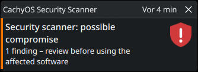

# 🔔 Tray icon and notifications

← [Help overview](README.md)

The app lives in the system tray. The icon tells you the state of the **last scan** at a glance.

## Icon states

| Icon | State | Meaning |
|---|---|---|
| 🛡️ blue | no result yet | the app just started and has not scanned yet |
| 🟢 green shield | **clean** | all enabled scanners ran and found nothing |
| 🟠 orange shield | **warning** | at least one finding of warning level, none critical |
| 🔴 red shield | **critical** | at least one critical finding (for example a package from the blocklist) |
| ❌ red cross | **error** | an enabled scanner could not run, or no scanner is enabled |

Good to know:
- With several scanners the **worst finding wins**: warning + critical = red; a warning together with a scanner that
  could not run = orange (the finding matters more than the error).
- A scan that was **skipped** (gaming mode, battery) does *not* change the icon, so an earlier finding stays visible.
- A threat found by a [ClamAV binary scan](setup-clamav.md) turns the icon red as well, until the next package scan.
- The tooltip (hover) shows the summary of the last scan.

## Mouse actions

| Action | Result |
|---|---|
| **Left click** | opens the [scan history](scan-history.md) (or brings it to the front if already open) |
| **Right click** | opens the menu below |

## The menu

```
Check for compromised packages now
Scan binaries with ClamAV (clamd)
Scan history…
─────────────────────────────
Check for app updates
Restart to apply update          ← only visible when an update waits
Settings…
Quit
```

| Entry | What it does |
|---|---|
| **Check for compromised packages now** | runs a package scan right away (all enabled scanners). Never skipped by gaming mode; always reports its result, also when clean |
| **Scan binaries with ClamAV (clamd)** | opens a terminal window with a live `clamdscan` of your configured paths. Greyed out if `clamdscan` is not installed (see [Set up ClamAV](setup-clamav.md)) |
| **Scan history…** | opens the [scan history](scan-history.md). Only one history window exists at a time |
| **Check for app updates** | manual update check. With automatic updates switched off it only *asks* before installing, see [Updates](updates.md) |
| **Restart to apply update** | restarts the app now to use an installed update. Otherwise it restarts by itself when idle |
| **Settings…** | opens the [settings](settings.md) (one window at a time) |
| **Quit** | stops the app. Nothing keeps running in the background |

## Notifications

Notifications use the standard desktop mechanism (`notify-send`, part of `libnotify`), so they look like every other
notification of your desktop.

| Notification | When | Urgency |
|---|---|---|
| **Security scanner: possible compromise** | a scan found something | critical – stays until you dismiss it |
| **Security scan finished** | your manual scan finished; or an automatic scan finished clean and *Also notify when nothing was found* is on; or a scan was incomplete | normal (critical if incomplete) |
| **Binary scan: threats found** | an automatic ClamAV scan found threats | critical |
| **Binary scan did not run** | e.g. `clamd` is not running | normal |
| **Update check / Security scanner updated** | manual update check results, or an update was installed | normal |
| **Update waiting** | an update is installed but the restart waits (a scan runs, or a window is open) | normal |

When something is found, a [findings window](findings-window.md) opens along with the notification.

### 🖱️ Clicking a notification
Notifications about a **finding, a binary-scan threat or a scan that could not run** are clickable. A click on the
notification (or on its **Open scan history** button) opens the [scan history](scan-history.md) with the **newest
matching entry already selected**, so you see the cause at once. Filters in the window are cleared so they cannot hide it.

| Notification | Entry that gets selected |
|---|---|
| possible compromise | newest entry with status warning or critical |
| binary scan: threats found | newest binary-scan entry with threats |
| scan incomplete / binary scan did not run | newest entry with status error |

Limits: a notification can only be clicked while it is still shown – once your desktop has moved it into its history, a
click may do nothing (the tray icon's left click always works). It needs a `libnotify` with `notify-send --action`
(current Arch has it); with an older one the notification is shown without the click feature.



> 🔕 No notifications at all? You need a notification daemon (KDE Plasma and GNOME have one) and `libnotify`.
> See [Requirements](setup-requirements.md#-notifications).

## Tray icon missing?

KDE Plasma, XFCE, Cinnamon, MATE, LXQt and others show it out of the box. **Stock GNOME does not show tray icons**;
install an AppIndicator extension. Details: [Requirements](setup-requirements.md#-system-tray).
