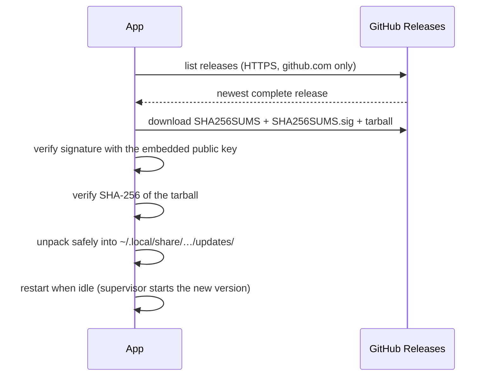

# 🔄 Updates

← [Help overview](README.md)

The app can update itself. This page explains what that means, how it is kept safe and how to control it.

## The short version

| Question | Answer |
|---|---|
| Where do updates come from? | **Only** the project's [GitHub Releases](https://github.com/ruepp-jenkins/cachyos-security-scanner/releases) |
| Are they checked? | ✅ Every update is **signed**; the app verifies signature and checksum before installing anything |
| Where are they installed? | In **your home folder** (`~/.local/share/cachy-security-scanner/updates/`), never into system folders |
| When? | 30 seconds after start, then daily (if automatic updates are on) |
| When does it restart? | By itself, when **no scan runs and none of its windows is open** |
| Can I turn it off? | ✅ *Settings → Check for app updates automatically…* |

## How it works, step by step

- The app is plain Python, so an update is only the program's code as a tarball (`cachy_sec`).
- The public key that checks the signature is **built into the app**. Without a valid signature or checksum **nothing is
  installed** ("fail closed").
- Unpacking refuses absolute paths, `..` and links.
- The installed pacman package is never changed. The downloaded version is placed *on top* when the app starts. If that
  new version **crashes within 30 seconds** of starting, it is thrown away and the packaged version runs again.
- When a newer pacman package arrives later, the downloaded copy is dropped.

## Automatic vs. manual

| Setting *Check for app updates automatically and install them* | Automatic check | Menu **Check for app updates** |
|---|---|---|
| ✅ **on** (default) | 30 s after start, then daily; installs without asking | looks and installs without asking |
| ⬜ **off** | none | looks and then shows a window *"Version X is available … Install it now?"* – you decide |

After the installation the app restarts itself as soon as it is idle. While it waits, the tray entry
**Restart to apply update** says why (for example *waiting: the window "Scan history" is open*), and after a minute a
notification explains it. Clicking the entry restarts immediately.

> 🔁 The restart works when the app was started through its launcher `cachy-security-scanner` (menu entry, autostart).
> When you start it by hand from source, there is no supervisor to relaunch it: the app tells you to start it again.

## What updates cannot do

Updates replace **Python files only**. Changes to system files – the pacman hook, new package dependencies – come with a
newly installed package: download the new `.pkg.tar.zst` from the release and install it with `sudo pacman -U`.

## Checking your version

- **Settings → bottom of the dialog**: *version X* and, if one is waiting, *update Y installed, applied on restart*.
- The help button opens the documentation of the **tag of your version**.

## If an update does not install

| Symptom | Check |
|---|---|
| "download failed" | network / GitHub reachable? |
| "signature verification failed" | do not retry blindly: report it in an issue. It can also mean the release is incomplete |
| "no release signing key configured" | a development build without the embedded key |
| nothing happens | automatic updates off? Use *Check for app updates* in the tray menu |
| restart never comes | a window is open or a scan is running; close it, or use *Restart to apply update* |

More on the trust model for maintainers: [Maintainer notes](maintainers.md#how-updates-reach-users).
